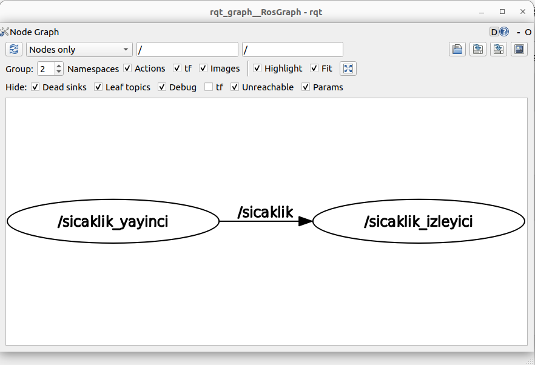
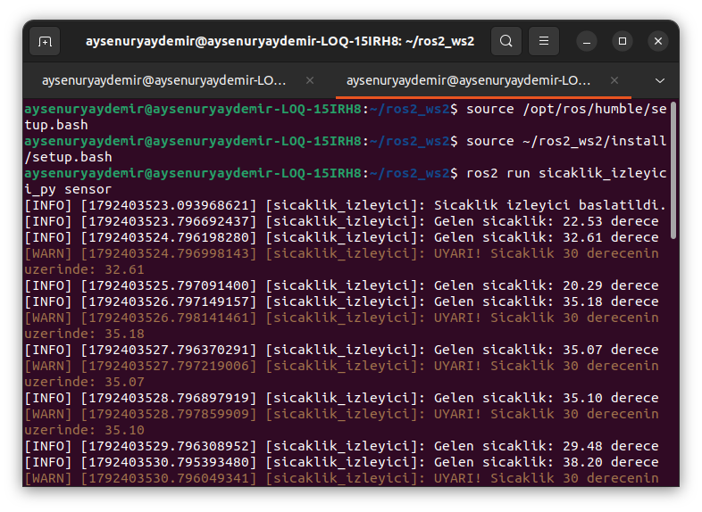
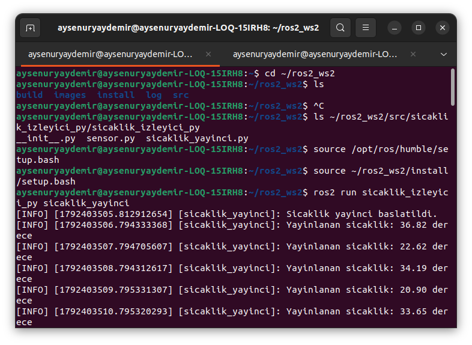

# ROS 2 Sıcaklık İzleyici Paketi (`sicaklik_izleyici_py`)

Bu proje, ROS 2 (Humble Hawksbill) kullanılarak Python programlama diliyle geliştirilmiş, sıcaklık değerlerini simüle eden bir yayıncı (`sensor`) ve bu değerleri dinleyerek eşik aşımı durumlarında uyarı üreten bir abone (`izleyici`) düğümü içeren bir ROS 2 Python paketidir.

Sistem, ROS 2'nin yayıncı-abone (Publisher-Subscriber) iletişim mimarisini kullanarak düğümler arasında veri alışverişini gerçekleştirir. Yayıncı düğüm tarafından üretilen sıcaklık değerleri `/sicaklik` isimli topic üzerinden iletilirken, abone düğüm bu değerleri sürekli dinleyerek belirlenen sıcaklık eşiğini aşan durumları tespit eder. Ayrıca `esik_deger` parametresi sayesinde uyarı sınırı çalışma sırasında değiştirilebilir.

---

## 📂 Proje Yapısı

- **`sensor` (Yayıncı Düğüm):** Rastgele sıcaklık değerleri üretir ve bu değerleri `/sicaklik` topiği üzerinden düzenli aralıklarla yayınlar.
- **`izleyici` (Abone Düğüm):** `/sicaklik` topiğini dinler, gelen sıcaklık verilerini terminale yazdırır ve belirlenen eşik değerle karşılaştırır.
- **Parametre Desteği (`esik_deger`):** Sıcaklık uyarı sınırının dinamik olarak değiştirilebilmesini sağlar. Varsayılan eşik değeri `30.0 °C` olarak belirlenmiştir.
- **Mesaj Türü (`Float32`):** Sıcaklık değerlerinin ROS 2 düğümleri arasında sayısal veri olarak iletilmesini sağlar.

---

## 📊 RQT Graph ve Terminal Çıktıları

### 1. RQT Graph Çıktısı

Aşağıdaki `rqt_graph` görselinde, ROS 2 ekosisteminde yayıncı ve abone düğümleri arasındaki veri iletişim yapısı gösterilmektedir. Sistem içerisinde `sensor` düğümü sıcaklık verilerini `/sicaklik` isimli topic üzerinden yayınlarken, `izleyici` düğümü aynı topic üzerinden bu verileri almaktadır.

ROS 2'nin dağıtık iletişim mimarisi sayesinde düğümler birbirlerinden bağımsız olarak çalışabilmekte ve topic tabanlı haberleşme mekanizması üzerinden veri alışverişi gerçekleştirebilmektedir. Böylece sıcaklık verilerinin üretilmesi ve bu verilerin kontrol edilmesi iki ayrı düğüm üzerinden yürütülmektedir.

### 2. Sensor Düğümü Terminal Çıktısı

`sensor` düğümünün terminal çıktısı incelendiğinde, sistemin `rclpy` altyapısını kullanarak periyodik olarak sıcaklık değerleri ürettiği görülmektedir. Üretilen sıcaklık değerleri, ROS 2 mesaj türlerinden `std_msgs/msg/Float32` kullanılarak `/sicaklik` topiği üzerinden yayınlanmaktadır.

Terminalde görüntülenen sıcaklık değerleri, sistemin simülasyon amacıyla oluşturduğu ölçüm verilerini temsil etmektedir. Yayıncı düğümün düzenli aralıklarla çalışması sayesinde abone düğüm, sıcaklık değerlerini sürekli olarak alabilmekte ve bu verileri eşik kontrolü için kullanabilmektedir.

### 3. İzleyici Düğümü Terminal Çıktısı

`izleyici` düğümünün terminal çıktısı, sistemin sıcaklık kontrolü ve uyarı mekanizmasını göstermektedir. Düğüm, `/sicaklik` topiğinden aldığı sıcaklık verilerini terminale yazdırmakta ve gelen değerleri tanımlanan `esik_deger` parametresiyle karşılaştırmaktadır.

Sıcaklık değerinin varsayılan `30.0 °C` eşik değerini aşması durumunda sistem, `[WARN]` seviyesinde bir uyarı mesajı üretmektedir. Böylece belirlenen sıcaklık sınırının üzerindeki değerler otomatik olarak tespit edilmekte ve kullanıcıya bildirilmektedir. Eşik değerin parametre aracılığıyla değiştirilebilmesi, sistemin farklı sıcaklık sınırlarına göre yeniden yapılandırılmasına olanak tanımaktadır.

### 4. Ek Ekran Görüntüsü

Aşağıdaki ekran görüntüsü, projenin geliştirilmesi veya çalıştırılması sırasında alınan ek görseli içermektedir.

---

## 🚀 Kurulum ve Çalıştırma

Projeyi kendi çalışma alanınızda (ros2_ws/src) çalıştırmak için aşağıdaki adımları izleyebilirsiniz:
    cd ~/ros2_ws
    
    colcon build --packages-select sicaklik_izleyici_py
    
    source install/setup.bash

## 👩‍💻 Geliştirici

**Ayşe Nur Yaydemir**

GitHub: [Ayse-Nur-Yaydemir](https://github.com/Ayse-Nur-Yaydemir)

Proje deposu: [sicaklik_izleyici_py](https://github.com/Ayse-Nur-Yaydemir/sicaklik_izleyici_py)
